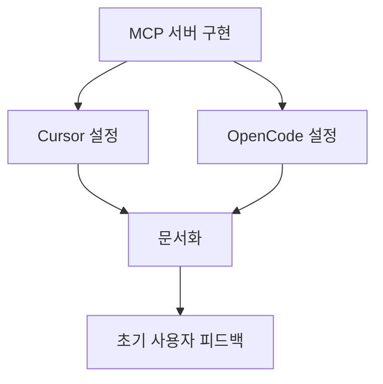
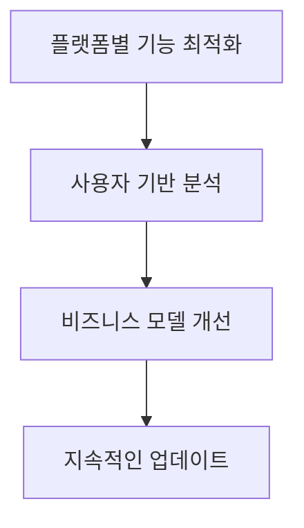

# MCP KIPRIS 플랫폼별 확장 전략 분석

## 📊 종합 평가

| 플랫폼 | MCP 지원 | 개발 난이도 | 사용자 기반 | 개발 시간 | 추천도 |
|---------|-----------|-------------|------------|-----------|--------|
| **Cursor** | ✅ 네이티브 (3가지 전송) | 낮음-중간 | 높음 (20만+) | 2-5일 | ⭐⭐⭐⭐⭐⭐ |
| **OpenCode** | ✅ 네이티브 (local+remote) | 낮음 | 중간 (성장중) | 1-3일 | ⭐⭐⭐⭐⭐ |
| **Gemini Code** | ❌ 네이티브 미지원 | 중간 | 매우 높음 (280만+) | 1-2주 | ⭐⭐⭐ |
| **Antigravity** | ❌ 미확정 | 높음 (초기단계) | 낮음 (실험적) | 2-4주 | ⭐⭐ |

---

## 🎯 최종 추천 전략

### **1순위: Cursor IDE** (가장 추천)

#### ✅ 장점
- **완벽한 MCP 네이티브 지원**: stdio, SSE, HTTP 3가지 전송 방식
- **거대한 사용자 기반**: 20만+ 개발자, Fortune 500 50% 사용
- **VS Code 생태계 호환**: 기존 확장 지식 재사용 가능
- **풍부한 문서**: 공식 MCP 통합 가이드 제공

#### 🔧 구현 방법
```json
// cursor/settings.json
{
  "mcpServers": {
    "kipris": {
      "command": "npx",
      "args": ["-y", "@mcp-kipris/server"],
      "env": {
        "KIPRIS_API_KEY": "${env:KIPRIS_API_KEY}"
      }
    }
  }
}
```

#### ⏱️ 개발 계획 (2-5일)
- **1일차**: MCP 서버 TypeScript SDK로 구현
- **2-3일차**: Cursor MCP 설정 테스트 및 최적화
- **4-5일차**: 문서화 및 예제 작성

---

### **2순위: OpenCode** (차선책)

#### ✅ 장점
- **MCP 퍼스트 클래스 시민**: 로컬/원격 서버 모두 지원
- **쉬운 설정**: 코드 없이 JSON配置만으로 연동
- **개발자 친화적**: 오픈소스, 빠른 성장
- **가장 빠른 구현**: 1-3일 만에 가능

#### 🔧 구현 방법
```jsonc
// opencode.jsonc
{
  "$schema": "https://opencode.ai/config.json",
  "mcp": {
    "kipris": {
      "type": "local",
      "command": ["npx", "-y", "@mcp-kipris/server"],
      "enabled": true,
      "environment": {
        "KIPRIS_API_KEY": "${env:KIPRIS_API_KEY}"
      }
    }
  }
}
```

#### ⏱️ 개발 계획 (1-3일)
- **1일차**: 기존 MCP 서버를 OpenCode 설정에 맞춤
- **2일차**: 원격 서버 구현 및 테스트
- **3일차**: 문서화 및 배포

---

### **3순위: Gemini Code** (장기적 고려)

#### ✅ 장점
- **압도적인 사용자 기반**: VS Code 280만+ 다운로드
- **구글 생태계**: Google Cloud와 통합
- **성숙한 플랫폼**: 안정적이고 잘 문서화됨

#### ⚠️ 단점
- **MCP 네이티브 지원 없음**: 커스텀 통합 필요
- **복잡한 구현**: VS Code 확장 + Gemini API 연동
- **제한된 기능**: Gemini의 도구 호출 API에 종속

#### 🔧 우회 구현법
```typescript
// VS Code 확장 내에서 Gemini API와 MCP 브릿지
class KiprisGeminiBridge {
  async searchPatents(query: string) {
    // Gemini의 tool calling API 사용
    const response = await gemini.callTool('kipris_search', { query });
    return response;
  }
}
```

#### ⏱️ 개발 계획 (1-2주)
- **1주차**: VS Code 확장 기본 구조 + Gemini API 연동
- **2주차**: MCP-브릿지 구현 및 테스트

---

### **4순위: Antigravity** (미래 관망)

#### ⚠️ 현황
- **실험적 플랫폼**: 2025년 11월 출시, 아직 초기 단계
- **문서 부족**: 공개된 확장 API 거의 없음
- **불확실성**: Google이 어떻게 확장 생태계를 만들지 미정

#### 🔮 미래 전망
- **Google 지원**: 장기적으로 잠재력 있음
- **에이전트 중심**: 전통적인 확장보다는 AI 에이전트 기반
- **관망 필요**: 공개 API 발표까지 기다리는 것이 합리적

---

## 🚀 실행 전략

### **Phase 1: 빠른 출시 (1주차)**


### **Phase 2: 생태계 확장 (2-3주차)**


### **Phase 3: 장기적 통합 (4주차 이후)**


---

## 🛠️ MCP 서버 구현 예제

### 핵심 서버 코드 (TypeScript)
```typescript
// src/server.ts
import { Server } from '@modelcontextprotocol/sdk/server/index.js';

const server = new Server(
  {
    name: "kipris_patent_search",
    description: "Korean patent database search via KIPRIS API"
  },
  {
    capabilities: {
      tools: {}
    }
  }
);

// 도구 정의
server.setRequestHandler('tools/list', async () => {
  return {
    tools: [
      {
        name: "patent_applicant_search",
        description: "Search patents by applicant name",
        inputSchema: {
          type: "object",
          properties: {
            applicant: { type: "string", description: "Applicant name" },
            docs_count: { type: "number", default: 10 }
          }
        }
      },
      // ... 다른 도구들
    ]
  };
});

// 도구 실행 핸들러
server.setRequestHandler('tools/call', async (request) => {
  const { name, arguments: args } = request.params;
  
  try {
    switch (name) {
      case 'patent_applicant_search':
        return await searchPatentsByApplicant(args);
      case 'patent_keyword_search':
        return await searchPatentsByKeyword(args);
      // ... 다른 케이스들
      default:
        throw new Error(`Unknown tool: ${name}`);
    }
  } catch (error) {
    return {
      content: [{
        type: "text",
        text: `Error: ${error.message}`
      }],
      isError: true
    };
  }
});
```

### NPM 패키지 설정
```json
{
  "name": "@mcp-kipris/server",
  "version": "1.0.0",
  "description": "KIPRIS patent search MCP server",
  "main": "dist/server.js",
  "bin": {
    "mcp-kipris": "./dist/server.js"
  },
  "keywords": ["mcp", "kipris", "patent", "korean"],
  "scripts": {
    "build": "tsc",
    "dev": "tsx src/server.ts"
  }
}
```

---

## 📈 성공 지표

### **단기 목표 (1개월)**
- [ ] Cursor 및 OpenCode에서 완벽하게 동작
- [ ] 100+ 활성 사용자 확보
- [ ] MCP 레지스트리에 등록
- [ ] 기술 블로그 및 문서 완성

### **중기 목표 (3개월)**
- [ ] Gemini Code와 커스텀 연동 완료
- [ ] 1,000+ 활성 사용자
- [ ] 플랫폼별 기능 최적화
- [ ] 커뮤니티 피드백 반영

### **장기 목록 (6개월)**
- [ ] Antigravity 공개 API 연동
- [ ] 10,000+ 활성 사용자
- [ ] B2B 서비스 모델 구축
- [ ] 글로벌 특허 데이터베이스 연동

---

## 💡 추가 제언

### **마케팅 전략**
1. **타겟**: 특허 변리사, R&D 부서, 스타트업
2. **채널**: Cursor/VS Code 마켓플레이스, 기술 커뮤니티
3. **가치 제안**: "한국 특허 검색을 코딩 워크플로우에 통합"

### **수익화 모델**
- **프리미엄 기능**: 대량 검색, 분석 도구, 알림
- **기업판**: API 키 관리, 팀 콜라보레이션, SLA 보장
- **오픈소스**: 기본 기능 무료, 커뮤니티 기반 개발

### **기술적 우위**
- **한국 특허 특화**: KIPRIS API에 대한 깊은 이해
- **안정성**: Rate limiting, 재시도 메커니즘, 보안 로깅
- **플랫폼 중립**: MCP 표준으로 모든 IDE 지원 가능

---

## 🎯 결론

**Cursor IDE**와 **OpenCode**에서 즉시 시작하는 것을 강력히 추천합니다. 두 플랫폼 모두 MCP를 네이티브로 지원하며, 개발 난이도가 낮고 사용자 기반이 확실합니다.

**실행 순서:**
1. **즉시**: Cursor + OpenCode MCP 서버 개발 (1주)
2. **단기**: Gemini Code 연구 및 구현 (2-3주)
3. **장기**: Antigravity 및 기타 플랫폼 모니터링

이 전략은 **최소한의 개발 노력으로 최대한의 사용자 도달**을 가능하게 하며, 동시에 **미래 확장성**을 확보하는 가장 현실적인 접근 방식입니다.